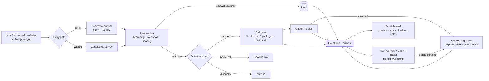

# 24/7 AI Lead Intake → Estimate → Quote → Onboarding Platform

A self-contained front door for a field-service business. It grabs attention, captures and qualifies leads, runs demos, prices jobs, sends e-signable quotes and onboards new customers **around the clock, while every crew is out in the field**. Everything syncs to **GoHighLevel**, fans out to **twin.so / n8n / Make / Zapier**, and runs on **any OpenAI-compatible LLM**: OpenRouter, a local Ollama or LM Studio model, or OpenAI. If no model is configured it still works, using deterministic rules.

- **Zero runtime dependencies.** Node ≥ 20 stdlib only: no `npm install` and no supply-chain surface.
- **Config, not code.** Questions, branching, scoring, prices, packages, onboarding steps and the AI persona all live in `app/config/*.json`. You can clone it for a new vertical or client in an afternoon.
- **The LLM never sets prices.** Models handle the language. The rules engine owns what to ask next, the scores and every dollar, so prices are auditable and can't be hallucinated.
- **Durable automation.** Every business event goes to an outbox with retry and backoff, so an outage at GHL or a webhook target never loses a lead.
- **Deploys with this repo's Fabric modules** to Cloud Run (always warm), Secret Manager (write-only secrets) and GCS (persistent store).

---

## 1. Funnel & system flow



### Trigger → Condition → Action (what fires automatically)

| Trigger (event) | Condition | Action (built-in) | Suggested automation (GHL / twin.so / n8n) |
|---|---|---|---|
| `lead.created` | email or phone captured | GHL upsert contact, tags `ai-intake`, `svc-*`, `tier-*`; opp → **New** | Speed-to-lead SMS within 60 s |
| `lead.qualified` | all required answers + tier hot/warm | GHL opp → **Qualified**, qualification note | Hot: ring the on-call estimator. Warm: 7-day nurture sequence |
| `estimate.ready` | outcome = `estimate` | Note with the price range | "Your estimate is saved" email and review link |
| `handoff.requested` | prospect asks for a human | tag `wants-human` | Page the owner or dispatcher |
| `quote.sent` | quote generated (chat "yes" or package click) | GHL opp → **Quoted**, value = package total | Follow up at 24 h, 72 h, then 7 d with financing angle |
| `quote.declined` | prospect declines | tag `quote-declined` | Win-back: offer the lower package or financing |
| `quote.accepted` | typed signature + terms accepted | GHL opp → **Won**, onboarding created | Welcome SMS, create the job in your FSM, notify crew lead |
| `onboarding.task_completed` | client or team finishes a step | GHL note | Update the job record |
| `onboarding.completed` | all steps done | tag `onboarded` | Dispatch or schedule the install |
| `lead.disqualified` | outside service area, etc. | tag `disqualified` | Long-term nurture list |

---

## 2. Quick start (2 minutes)

```bash
cd apps/lead-intake-platform/app
cp .env.example .env          # optional: everything works without keys
npm test                      # 11 tests: engine, pricing, LLM failover, full funnel
npm run dev                   # http://localhost:8080
```

| URL | What it is |
|---|---|
| `/` | Landing page with hook, proof and a 20-second proactive chat |
| `/#/estimate` | Conditional-logic estimate wizard |
| `/#/quote/<id>` | Quote with line items, packages, terms, guarantee and e-sign |
| `/#/onboarding/<id>` | Self-serve onboarding portal |
| `/#/admin` | Funnel KPIs and lead table (needs `ADMIN_TOKEN`) |
| `/?embed=1` | Chat-only mode for iframes |
| `/embed.js` | One-line widget for any site |

**Embed on a GHL funnel, WordPress, Webflow or Wix.** Paste this into the page's custom code:

```html
<script src="https://YOUR-SERVICE-URL/embed.js" defer></script>
```

UTM, gclid and fbclid parameters are passed through to the lead and to GHL, so every closed job can be traced back to the ad that produced it.

---

## 3. Configure the business (no code)

| File | Controls |
|---|---|
| `config/flow.json` | Steps, questions (`single` / `multi` / `number` / `text` / `email` / `phone`), `showIf` branching, `pattern` validation, per-option `score`, scoring rules, hot/warm/cold tiers, outcomes (`estimate` / `book_call` / `disqualify`) |
| `config/pricing.json` | Per-service line items with `when` conditions, `qtyField` / `qtyMap`, multipliers, minimum job charge, Good/Better/Best packages, discounts, financing APR/term, deposit %, terms, guarantee |
| `config/onboarding.json` | Common and per-service onboarding tasks, owner (`client` / `team`), forms, due dates, `when` conditions, Stripe deposit link |
| `config/agent.json` | Persona, greeting, proof points, demo script, objection handlers, landing copy |

**One condition language everywhere** (questions, steps, prices, scoring, onboarding):

```json
{ "all": [
  { "field": "service", "value": "roofing" },
  { "field": "roof_issue", "op": "in", "value": ["storm_damage", "full_replacement"] },
  { "not": { "field": "zip", "op": "regex", "value": "^(?!7[5-9])" } }
]}
```

Operators: `eq neq in nin gt gte lt lte between exists empty contains regex`.

The sample config is a roofing, HVAC and remodel contractor in Texas. Replace the prices with your real numbers before going live.

---

## 4. LLMs: portable, with failover

All providers speak the OpenAI `/chat/completions` dialect. They're tried in `LLM_PROVIDER_ORDER`, and the first one that answers wins:

| Provider | Env | Notes |
|---|---|---|
| OpenRouter | `OPENROUTER_API_KEY`, `OPENROUTER_MODEL` | One key reaches hundreds of models. Swap models without code changes. |
| Local / portable | `LOCAL_LLM_BASE_URL`, `LOCAL_LLM_MODEL` | Ollama `http://localhost:11434/v1`, LM Studio `:1234/v1`, vLLM, llama.cpp. $0 per token, and data stays on your hardware. |
| OpenAI | `OPENAI_API_KEY`, `OPENAI_MODEL` | Fallback |
| *(none)* | — | Rules-only mode: regex and keyword extraction plus template replies. The funnel never goes down. |

The model has two jobs: (1) extract structured answers from free text as JSON, validated against the flow schema, and (2) write a short, on-brand reply that asks exactly the next question the engine chose. `GET /healthz` shows the health of each provider.

**opencode.** `app/opencode.json` points the opencode coding agent at OpenRouter with this README as context. Run `opencode` inside `app/` to extend flows, prices or integrations.

---

## 5. Integrations

### GoHighLevel (LeadConnector API v2)
1. In GHL, go to **Settings → Private Integrations**, create a token with contacts and opportunities read/write scopes, and set `GHL_API_KEY`.
2. Set `GHL_LOCATION_ID` and `GHL_PIPELINE_ID`, plus the stage IDs `GHL_STAGE_NEW`, `_QUALIFIED`, `_QUOTED` and `_WON`.
3. Build GHL workflows on the **tags** this app sets (`ai-intake`, `tier-hot`, `quote-sent`, `wants-human`, `won`, `onboarded`) or on pipeline stage changes.

### twin.so, n8n, Make, Zapier (signed webhooks)
- Set `TWIN_WEBHOOK_URL` to your twin.so agent's webhook or trigger URL. Add n8n, Make or Zapier catch hooks as a comma-separated list in `OUTBOUND_WEBHOOK_URLS`. If your twin.so agent can't receive webhooks directly, send them to n8n or Make and have that call the agent.
- Every event is POSTed as `{ id, type, occurredAt, lead, data, suggestedAction }`. `suggestedAction` is a plain-English next step that agentic receivers can execute.
- **Verify the signature:** `hex(HMAC_SHA256(WEBHOOK_SIGNING_SECRET, X-Timestamp + "." + rawBody)) == X-Signature`.

### Inbound (automations → platform)
`POST /api/webhooks/inbound` is signed the same way with `INBOUND_WEBHOOK_SECRET`:

```json
{ "type": "onboarding.task_complete", "onboardingId": "ob_…", "taskId": "materials" }
{ "type": "lead.update", "leadId": "lead_…", "fields": { "stage": "won", "owner": "Mike" } }
```

This lets a GHL workflow, a twin.so agent or a crew-lead text tick off team steps such as "Materials ordered" or "Install date confirmed", so the client sees progress in their portal right away.

### Stripe
Set `STRIPE_PAYMENT_LINK` to a Payment Link. The onboarding deposit step links to it with `client_reference_id=<quote id>` so you can reconcile payments automatically.

---

## 6. API

| Method | Path | Purpose |
|---|---|---|
| POST | `/api/chat` | `{sessionId?, message, source?}` returns the reply, next question and chips, score, estimate, and a quote if the prospect said "yes, lock it in" |
| POST | `/api/survey/step` | Returns the visible steps for the current answers and validation errors for a step |
| POST | `/api/survey/submit` | Returns the lead, score, outcome and estimate |
| POST | `/api/estimate` | Price preview (no lead) |
| POST | `/api/quotes` | `{leadId, packageId}` creates a quote |
| GET | `/api/quotes/:id` | Quote (records `viewedAt`) |
| POST | `/api/quotes/:id/accept` | `{signature, agree}` signs the quote and creates onboarding |
| POST | `/api/quotes/:id/decline` | `{reason}` |
| GET / POST | `/api/onboarding/:id[/tasks/:taskId]` | Portal read / complete a client task |
| POST | `/api/webhooks/inbound` | Signed automation callbacks |
| GET | `/api/admin/metrics`, `/api/admin/leads` | Bearer `ADMIN_TOKEN` |

---

## 7. Deploy to Google Cloud (Fabric modules)

`terraform/` uses this repo's `artifact-registry`, `iam-service-account`, `gcs`, `secret-manager` and `cloud-run-v2` modules:

- **Cloud Run** with `min=1` (always warm, answers in under a second at 3 a.m.) and `max=1` (a single writer for the file store).
- **GCS FUSE volume** at `/data` with versioning, so leads, quotes and onboarding survive restarts.
- **Secret Manager write-only versions.** API keys never land in Terraform state. Pass them with `TF_VAR_secrets` and don't keep saved plan files, which contain input variables.

```bash
cd apps/lead-intake-platform/terraform
export TF_VAR_secrets='{"OPENROUTER_API_KEY":"…","GHL_API_KEY":"…","WEBHOOK_SIGNING_SECRET":"…","INBOUND_WEBHOOK_SECRET":"…","ADMIN_TOKEN":"…"}'
terraform init
terraform apply -var project_id=MY_PROJECT        # 1st pass: placeholder image
$(terraform output -raw build_command)             # build & push the app
terraform apply -var project_id=MY_PROJECT \
  -var image=$(terraform output -raw registry_url)/lead-intake:latest \
  -var 'app_config={BUSINESS_NAME="Acme Roofing",PUBLIC_BASE_URL="https://…",GHL_LOCATION_ID="…"}'
```

To rotate secrets, bump `-var secrets_version=2`. Running cost is roughly $15–40 a month for Cloud Run (always-on, 1 vCPU / 512 MiB), plus pennies for GCS and Secret Manager. LLM costs scale with conversations.

To scale out horizontally, swap `src/store.js` for Firestore or Postgres behind the same `get/put/patch/list` interface and raise `max_instance_count`.

---

## 8. KPIs to track (on `/#/admin`)

| KPI | Why it matters | Target |
|---|---|---|
| Capture rate (leads ÷ conversations) | Measures the funnel hook and copy | 25–40% |
| After-hours leads | Revenue that would otherwise go to voicemail | Track the $ value |
| Qualified % | Keeps estimator time for real buyers | > 50% of leads |
| Quote → won (close rate) | Package and price fit | 25–40% |
| Booked revenue and open pipeline | Cash flow forecast | ↑ week over week |
| Outbox dead-letters | Integration health | 0 |

**Financial model.** At 100 conversations a month, 30% capture gives 30 leads. A 35% close rate at an $11k average ticket is about **$115k a month booked**. If 40% of those leads arrive after hours (common in field service), that's roughly **$46k a month that previously went to voicemail**.

---

## 9. Security notes
- Every user and server string is rendered with `textContent`: no `innerHTML`, no XSS.
- Chat is rate-limited per IP. Bodies are capped at 64 KB. Static serving is path-normalized.
- Quote and onboarding links use unguessable 64-bit random IDs. Admin endpoints require a bearer token.
- Inbound webhooks require an HMAC signature within a 5-minute timestamp window.
